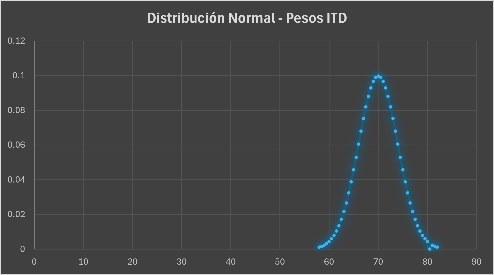

# Ejercicio: Distribución Normal de Pesos en Estudiantes del ITD

**Datos del problema:**
* **Población total (N):** 500 estudiantes
* **Media poblacional (μ):** 70 kg
* **Desviación estándar (σ):** 4 kg

---

### 1. Probabilidad de que los estudiantes pesen más de 68 y menos de 72 kg

Para transformar un valor a su correspondiente calificación Z en una curva normal estándar, utilizamos la ecuación:
**Z = (x - μ) / σ**

* **Límite inferior (68 kg):**
  **Z1 = (68 - 70) / 4 = -0.5**
* **Límite superior (72 kg):**
  **Z2 = (72 - 70) / 4 = 0.5**

La probabilidad deseada corresponde al área bajo la curva normal estándar entre Z1 = -0.5 y Z2 = 0.5. Buscando en la tabla de distribución normal acumulada:
* P(Z < 0.5) ≈ 0.6915
* P(Z < -0.5) ≈ 0.3085

Restando el límite inferior del límite superior:
**P(-0.5 < Z < 0.5) = 0.6915 - 0.3085 = 0.3830**

---

### Conclusión:
La probabilidad de que un estudiante pese entre 68 y 72 kg es de **0.3830** (es decir, el **38.3%**).

Para calcular **cuántos estudiantes** representan, multiplicamos esa probabilidad por el tamaño original de la muestra (500):
**500 x 0.3830 = 191.5**

Redondeando al número entero más cercano, se estima que aproximadamente **192 estudiantes** pesan dentro de este rango.

---

###  Gráfica en Excel

